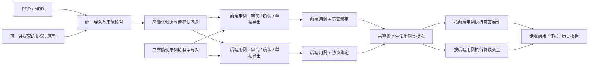

# 需求设计与后端测试：架构、实施与验收计划

版本：v4 · 2026-09-26。用户已同意共享 UI/后端测试流程，并进一步明确：PRD/MRD 生成前端、后端两组测试用例，两条执行链均由已确认用例驱动。协议可同批导入或后补；无协议但业务依据充分的后端业务用例可确认导出，仍待协议绑定。本文件保留实施设计并同步有限验收状态，不单独证明完整产品或真实业务验收。

## 当前状态卡

- 当前阶段：B1-B4已实现并在原4322正式工作台完成合成主路径部分验证；最终工程清单146项、0失败、0跳过；原7项目project.json摘要与重启前一致，完整VT矩阵仍未覆盖。B5未实现。
- 唯一目标：测试工程师在项目内完成资料到两组用例、后补协议和执行列表异常处理。
- 输入：用户已确认的项目/用例驱动流程、PRD/MRD主输入、可选协议/截图；合成验收资料不当真实业务。
- 有限交付：B1-B4代码、工程测试、独立审查、同一工作台验收记录；B5须首份实际协议和授权目标。
- 权限边界：不修改pm-req、不外发真实业务资料、不改数据根、不自动提交推送发布。
- 停止条件：完成本轮有限合成验收并如实列出未验范围；用户已授权主管按原配置自主重启同一4322，源码/配置/数据根指纹已核实。实际协议与非生产目标缺失时B5保持未实现。
- 实际证据：[本轮实现与验收记录](../../../workbench/qa/20260926-req0038/REPORT.md)及[正式入口指纹](../../../workbench/qa/20260926-req0038/official-current.json)。四张图片仍为设计参考，不能替代正式执行证据。

## 1. 一套公共流程，两个执行端

最外层是项目列表，选定项目后进入项目工作台，当前项目 ID 和名称持续可见。资料、前后端用例、协议绑定、脚本与执行批次、报告均归该项目。新用例主要从项目内 PRD/MRD 统一设计，生成时就标记前端或后端，分组审阅、确认和导出；已有确认用例仍可直接进入相应自动化链路。协议可在同一资料页上传，不另建“协议直接驱动后端测试”的平行产品流程。人工用例确认、脚本需求核对、正式批准、技术试跑和产品验收分别记录；生成与运行保留各自的确认操作。

### 协议是否必需：已确认的设计边界

协议与 PRD/MRD 可以一起导入。业务预期按实际原文共同取证，不能单凭文件名推断优先级；只有协议格式时不能编造业务结果。

- PRD/MRD 已给出触发、输入和明确预期时，缺少协议仍可设计、人工确认和导出有依据的后端业务用例；缺失的调用、字段或响应检查标“待协议绑定”，不补造技术步骤。
- 有协议也不保证每条用例完整：缺业务预期、字段约束不明或资料冲突时，相关条目继续待确认。
- 后端自动化生成或执行前必须具备所需协议定义、明确绑定和对应执行器；执行还需要环境、数据和授权。已有后端用例导入遵循相同条件，不能绕过。
- 协议定义可来自独立文档，也可已经包含在 PRD/MRD 或附件中；按所需内容是否齐全判断，不强制另造一个叫“协议”的文件。

当前 B4 绑定接口只接受已上传为 `PROTOCOL` 类别的不可变快照；若协议事实嵌在 PRD/MRD，须由测试工程师明确作为协议资料提交并核对，自动抽取或推断其技术映射尚未实现。

后补协议沿用已有后端用例身份，在协议与绑定页逐步核对用例步骤与接口或报文字段、单位、约束和观测方式。纯技术映射生成新的 binding 版本，原用例及旧导出保持不变；若协议改变业务预期或与其冲突，形成待核对的新候选用例版本，不能悄悄改旧用例。部分步骤映射不使整条用例可运行；全部绑定后仍须检查执行器、环境、数据及脚本核对状态。协议、用例或 binding 版本变化，都要重检相互适用性。

用例确认状态与自动化准备状态分开记录：业务用例可以确认导出，协议未绑定则不能进入相应自动化执行。这是用户已同意的设计边界。

### 对照当前代码的决策

| 层 | 已有事实 | 实施决定 |
| --- | --- | --- |
| 用例库 | `cases/store.mjs` 有项目修订号、版本数组；`cases/manager.mjs` 有 Excel/JSON 预览、来源、确认和导出 | 复用项目和用例版本；增加受校验的测试类型与需求来源元数据，不建立第二个用例库 |
| 需求设计 | 当前导入的是已写用例；导入确认允许待澄清用例以待确认状态入库 | 新建独立的资料/设计草稿域；只有人工确认的候选进入正式确认用例，不能套用上传即确认 |
| 脚本操作 | `script-operations.mjs` 已区分生成、按问题修订与从头重生成 | 复用请求、版本和预算语义，按类型选择生成契约；修订锁定旧候选和原用例 |
| 批次 | `batches.mjs` 有逐项预检、脚本选择、批次、取消和阻塞记录 | 共享调度；预检与执行分派到相应执行器，不把后端送进浏览器 |
| 技术执行 | 生成入口的环境检查与 `candidate-trials.mjs` 的执行证据链依赖网页、Playwright 与页面媒体 | UI 执行器保留；后端单独适配协议会话、报文与业务状态，再接回公共结果契约 |

## 2. 五项架构决策

### D1：资料与设计草稿独立，确认后复用用例库

已新增 `workbench/server/requirements/`，承担安全读取、资料快照、设计草稿、受限模型调用、候选验证与人工确认。资料与草稿绑定当前项目，数据存于当前数据根的独立子目录，不改数据根、不迁移旧项目。资料后续可显式复用，但不默认跨项目共享；项目复制与跨项目报表不属本轮。

资料与结果均追加版本。一个设计版本绑定精确的资料集合和本期范围，不能随文件更新悄悄改变内容。正文、表格、图片分别记录读取状态；部分读取必须在生成前可见。

每份快照保留原件不可变字节及摘要，引用绑定 `snapshot_id + segment_id/位置 + 原文摘要`。正文或表格未读区域形成明确的覆盖缺口；可依据已读片段生成候选，但不能标为来源完整。受影响候选须补读、补充依据或由人工明确采用范围后才能确认；影响范围不能判断时保持待核对。图片未分析只限制依赖图像的断言，不阻断独立的文字用例。

模型输入只包含已勾选、已授权的资料与范围，不给浏览器、Shell、文件写入或网络工具。附件中的文字均为参考数据。读取文件不调用模型；图片保留与识图分别计状态，模型未支持或未获图片授权时显示“未分析”，不能宣称已经理解原型。

### D2：来源引用可检查，业务正确性需要独立核对

每个候选步骤的预期关联一个或多个来源片段，保留文档、快照版本、段落/表格单元位置与原文。重复要求可以合并，但保留全部来源；冲突不预设 PRD 或 MRD 优先。

程序核对来源存在、位置与原文匹配、版本适用、字段完整和 unresolved 问题。引用真实原文不等于候选语义正确；独立语义审查和人工确认仍须核对规则是否被扩大、遗漏或改变。冲突和缺少判定依据只阻塞相关候选，允许其他独立完整候选继续。

无截图不阻断文字支持的功能用例。只有截图或协议格式时，不能编造后台规则、字段范围、权限、超时和错误码。用户补充业务判定时保存为可追溯的人工决定，而非静默改写原文。

### D3：类型属于不可变用例内容，旧版本不重写

同一设计版本输出前端、后端两个用例集合。默认分别导出 `前端测试用例.xlsx` 与 `后端测试用例.xlsx`，机器格式按同样类型分别导出 JSON；每份携带用例版本、来源、确认状态和绑定准备状态。待澄清项单列，不能因文件导出被提升为已确认。

同一业务规则可以分别对应两端用例，但应保留同一需求引用和不同验证目标：前端核对页面交互/展示，后端核对服务行为/状态。不能简单复制同一用例换标签；某一类证据不足时列出缺项，不为凑齐两份文件编造内容。该拆分由本工程处理，不要求 pm-req 改变原有 PRD/MRD 导出。

已在明确分类的新版本 `content` 中加入 `case_type: UI | BACKEND` 和需求来源引用。旧内容缺少类型时不猜测：已有明确 UI 脚本绑定的版本维持原 UI 执行兼容，其余显示“待分类”；选择类型产生新版本。只增加派生显示，不回写旧对象，不改变旧 `content_sha256`。

必须同时修改导入、编辑、确认、JSON 导出和 Excel 往返。当前 `updateCase()` 会重建 content，不能只在前端加字段，否则编辑会丢失类型和来源。UI 类型改为 BACKEND 必须形成新版本，旧 UI 脚本不得自动适用。

人工确认以设计版本和项目 revision 为条件，重复请求幂等；过期草稿、跨项目来源、无效引用和未解决问题不能靠直接 API 绕过。来源更新形成复核提示，保留旧用例、脚本和结果；不能把旧版本的确认视为新版本已确认。

设计候选入库只经绑定 design revision 的专用确认事务。对带设计来源的内容，通用 JSON 导入和 `updateCase()` 同样核对服务端 provenance，不得凭传入 `status=CONFIRMED` 绕过来源、覆盖缺口或冲突校验。与设计域无关的既有人工用例导入保持原行为，不能把导入包自述的“已确认”当作本设计域的人工确认记录。

### D4：共享生命周期，按执行器分派技术动作

执行分派须保留 `runner_kind` 与用例/环境/绑定版本一致性。当前 UI 保留页面执行器，BACKEND 仅实现执行资格拒绝和缺项预览；实际协议执行器及其脚本/环境 `runner_kind` 接线属 B5。生成与运行入口都须检查，不能只在 UI 隐藏按钮。

生成和重生成从原用例与绑定资料开始；问题修订额外使用选定旧脚本和指定反馈。每次产生新版本。重新运行已有脚本不调用模型，生成新批次，保留失败与旧结果。

项目内混合 UI/后端批次逐条保存脚本、环境、协议和用例版本。允许部分执行必须明确列出被执行与被阻塞条目，不能把部分结果称整个项目通过。取消、中断、登录失效和通信失败不自动重放有副作用的动作。

共享执行页面以原有多用例列表为主，支持筛选与详情；执行历史分页仍是后续能力。摘要统计与当前项目、批次和筛选范围一致；每条直接给出状态、失败摘要、原预期与实际观察简述以及证据/详情入口。失败、受阻、未执行分别显示，支持只看异常；相同报错可分组为“候选同因/待核对”，不能自动宣称根因。用户可选中当前项目失败集合批量发起反馈修订或原脚本复跑，仍保存每条结果和旧历史，不静默跳过。切换项目时清空选中集与旧筛选结果，不跨项目隐式合并用例、绑定、执行或证据。原脚本复跑不调用模型，启动前重检用例、脚本、绑定版本及执行条件。原历史批次2项1通过/1失败的列表、异常筛选、选组冻结预览与取消已在正式4322复核；未因此启动新的业务运行。

### D5：证据共享外壳，保留执行类型的事实

共享记录包含用例/脚本版本、目标版本、步骤、原预期、实际观察、结果、开始结束时间和证据引用。证据必须属于同一运行，不接受别的批次截图或报文拼接。

UI 保留截图、录像、页面轨迹和现有步骤观测。后端记录脱敏请求/响应或报文、关联标识、业务状态变化、协议规定的时间条件和清理结果。连接、认证、报文格式、业务断言、超时和清理分别分类；收到响应或成功状态码不能替代业务断言。清理失败不被成功的业务步骤掩盖。

## 3. 数据与接口契约

以下保留总体设计契约。B1-B4 的资料、设计候选、确认、绑定和执行缺项接口已在正式4322使用；`runner_kind` 后端执行、实际协议交互与后端证据仍属 B5，不把表内未来字段误认作已实现。

| 对象 | 必需身份与内容 | 状态/约束 |
| --- | --- | --- |
| SourceSnapshot | 项目、来源 ID、文件名/摘要、用户采用的文档版本与状态、分段原文、读取清单 | 不可变；正文/表格/图片分别为已读取、部分读取或未读取；系统摘要不代表人工签名 |
| DesignRevision | 设计 ID/版本、source refs、本期范围、模型文字/图片授权、模型及预算记录、规则/问题/候选 | 草稿、分析中、待核对、失败/取消；模型结果不能直接成为确认版本 |
| Candidate | 稳定候选 ID、case_type、模块、前置/数据、步骤/预期、多源引用、问题 refs | 待核对、需澄清、人工已确认；确认条件服务端校验 |
| Binding | 用例身份与内容摘要、runner_kind、页面或协议版本、逐步字段/单位/观测映射、目标环境、账号角色/凭据引用、准备/观察/清理边界 | 后补协议延续原用例，纯技术映射追加独立 binding 版本；部分映射不可整条运行，冲突走待核对用例候选；不保存明文凭据 |
| RunSnapshot | 精确用例/脚本/绑定版本、批次、目标版本、类型化步骤结果和证据索引 | 未执行、运行中、通过、失败、受阻、取消或中断；核对和批准状态独立 |

已在 `/api/case-library/projects/:projectId/requirements/` 下提供资料上传/列表、草稿建立、分析任务、候选编辑/确认和导出入口。返回项目归属、版本与 revision；写操作沿用现有同源保护，文件体量受独立限制。生成是可查询和取消的任务，不将长模型调用阻塞在一次页面保存里。

模型任务接纳、互斥、失败锁存、停机排空和健康状态须接入当前服务管理；新管理器不能在服务拒绝写入时继续接任务。读取、生成、确认和导出分别记账；不能因刷新页面重复调用模型或重复入库。

DOCX 先限制压缩/展开大小、文件数、路径、重复项及 XML 外部实体，读取正文和表格；不运行宏、嵌入对象、HTML 或外链。采用明确依赖的解析器，并评估锁文件与打包影响；不依赖 ExcelJS 的隐式子依赖当作正式 DOCX API。`.doc`、PDF、OCR 与可选 ZIP 增强不抢占首批主链路；未支持格式给出明确状态。

## 4. 实施批次与文件所有权

主管负责公共接口、共享文件合并、服务重载和最终验收。实现者不能给自己判产品验收通过。开始新批次前核对上一批证据；这属于主管内部检查，不要求用户反复确认已有决定。

| 批次 / 任务 | 有限交付与主要文件 | 依赖与负责方式 | 退出条件 |
| --- | --- | --- | --- |
| B1 / TK-0038-01 资料输入 | `requirements/documents/store`；PRD/MRD Markdown、DOCX正文/表格、可选图片的读取状态和不可变快照 | 执行 A；主管接 `app.mjs/index.mjs`，统一依赖和数据路径 | 有文档读取结果与错误分类；部分读取不冒充完整；无外发/执行附件；旧数据不变 |
| B2 / TK-0038-02 用例设计 | `requirements/model/manager`；PRD/MRD统一分析、前端/后端两组候选、来源、冲突、授权与预算 | B1 后执行 A；审查 C 独立核对语义；前端 B 可按已固定契约并行 | 不复制换标签、不补规则；来源缺失/资料冲突有独立结果；协议完整性不代替业务预期 |
| B3 / TK-0038-03 确认与复用 | `web-v2` 统一资料入口与两组审阅；`cases/manager/excel` 类型与来源；分别确认/入库及前后端各自Excel/JSON导出往返 | B2；执行 B 只写独立界面文件，主管负责共享 case 与路由变更 | 正式4322从资料到两组确认用例；无混类导出；旧导入/PATCH绕过反例；旧哈希与既有UI脚本保留 |
| B4 / TK-0038-04 共享自动化接续 | 新增协议与绑定页；后补协议逐步映射已有后端用例、独立 binding 版本与冲突候选；类型过滤、生成/批次分派及列表式执行/异常批量处理 | B3；主管组织公共生命周期改动并独立回归 | 技术映射不改旧用例/导出；部分映射不整条运行；绑定完成仍核对执行器/环境/数据/脚本，版本变化重检适用；列表摘要与范围一致、异常逐项留痕、复跑零模型；未知协议/执行器不落入 Playwright |
| B5 / TK-0038-05 首种协议闭环 | 按实际协议的一种执行器、后端生成契约、断言、数据准备与清理、真实证据报告 | B4 + 实际协议/业务依据 + 授权非生产目标 | 正常与指定失败均实测，零模型复跑与修订留痕；工程模拟与真实系统结论分别给出 |

初始最多两个并行实现 Agent，一个独立审查 Agent；主管保留集成与验收。共享文件只由主管修改或串行交接，禁止多个实现者同时改路由、主页面、用例 schema 或锁文件。按稳定基线使用一条功能分支，批次以提交/证据区分，不再为每个小模块增加长期分支；创建/提交/推送遵循当前授权。

成本控制：先离线解析、校验与工程反例，再调用真实模型；默认禁止自动重试和无界自修。首批真实语义验收预算最多4次文档模型请求，已全部用完：前2次JSON格式失败保留诊断，提示修复后第3次产生UI/BACKEND双组，第4次互斥规则产生0候选及阻断问题；没有自动增加额度补跑未覆盖分支。已发出的失败/取消请求及传输重试同样占额度。脚本复跑应为0次模型调用。供应商用量按实际回包记录，未配置价格时费用标未知，不编金额。此预算不包含Codex内部子Agent。

## 5. 主管验收标准

| 验证项 | 最小充分验证 | 必须能识别的反例 |
| --- | --- | --- |
| VT-0038-01 输入与范围 | 只有 PRD、只有 MRD、两份互补/重复/冲突；无图/有图未分析；DOCX正文/表格、部分读取与版本变更 | 空文件、恶意压缩结构、超限、读不到内容、范围外条目被混入 |
| VT-0038-02 语义与来源 | 每项预期可核对原文；独立评审候选，模型失败保留 | 真实引用但错误归纳、无图编控件、协议格式被扩写成业务规则、冲突被静默消解 |
| VT-0038-03 人工确认与复用 | 前后端分组确认/分别导出，逐条编辑、并发revision、导出往返与旧版本读回 | 混类导出、复制换标签、把待绑定当已执行，经旧导入/PATCH绕过设计确认、未知字段丢失 |
| VT-0038-04 公共生命周期 | 后补协议沿用用例、逐步绑定、纯技术新 binding 与业务冲突候选分开；列表摘要与批次/筛选范围一致，逐项结果和历史保留；异常筛选/候选同因分组、选中失败集合批量反馈/复跑，原脚本复跑零模型并核对版本/条件 | 旧导出被覆盖、部分映射冒充整条可运行、版本变化未重检、异常被静默跳过、同报错冒称根因、复跑偷调用模型 |
| VT-0038-05 后端真实执行 | 协议定义的正常读取、业务错误、权限、状态变化、异步/超时与清理；不适用项有依据 | 返回成功但业务值错误、串错响应、遗漏断言、单位/时间放宽、清理失败被隐藏 |

正式界面和联调只使用 `http://127.0.0.1:4322/workspace/`，原启动器、原数据根。需要加载修改时先检查活动任务，保留原配置和数据后重启原实例。不得另起工作台或用影子站结果替代验收。前一轮草图的本地文件预览限制不作为正式产品界面证据，也不绕过该限制。

主管最终读取实际 diff、工程结果、真实模型输出、正式浏览器旅程、原预期与逐步证据；子 Agent 自报和测试数量不是最终判定。完成实现后按当前 REQ 执行同步、证据收集和正式检查，不研究无关历史门禁。

## 6. 已决事项、未决事项与完成边界

- 已决：用户明确PRD/MRD生成前后端两组用例、分开处理；两条自动化链均由测试用例驱动；协议可一并导入；已有确认用例仍可直达。主管负责架构、分派与最终验收。
- 已决：用户同意无协议但 PRD/MRD 业务依据充分的后端用例可设计、确认和导出，具体技术步骤与自动化待协议绑定；协议齐全也须核对业务预期。后补协议延续已有用例，新增协议与绑定页。
- VALIDATE：DOCX正文/表格与工程包安装已做有限合成验证；真实模型结构输出前2次失败、修复后第3/4次形成可审候选与冲突阻断，不能推为全矩阵稳定。截图仅存档未分析；语义来源保真、混合批次与原7项目仍需按各自证据复核。
- DEFERRED：可选 pm-req handoff ZIP 增强、多协议并行、PDF/OCR、生产验证与发布；不阻塞 PRD/MRD 主链。
- B5 的真实阻塞：实际协议类型/版本、业务判定和允许连接的非生产环境尚未提供。B1–B4 不依赖这些资料；B5 不默认 HTTP，不把合成资料冒称用户业务协议，不用空执行器充数。
- 用户当前无需补输入。四张图片仅为合成设计参考，其中前三张是项目内局部页面；本轮已按正式4322的实际页面与接口验证部分交互。到 B5 前只提交一次缺项清单；已有资料可直接引用，不索取密码或 Token。整体后端“可用/验收完成”必须等真实协议闭环达成；合成业务路径不等于真实业务项目或发布验收。

## 本轮证据

主管按用户授权自主重启原4322并核实源码、配置、数据根指纹：[正式入口记录](../../../workbench/qa/20260926-req0038/official-current.json)。B1-B4合成主路径已运行：PRD Word+MRD经真实模型第3次得到前后端各1候选并分别确认导出；第4次互斥业务规则得0候选及BLOCKING问题，前2次JSON格式失败留存历史，不拼算成功。后端原样Excel回导0新增/1重复已确认；前端同结果仅预览未确认。

后补合成协议形成部分binding v1、完整确认v2，旧case v1/hash不变；冲突v3无模型形成待审设计，人工仅改步骤2预期并作两项决定后成为同case v2，旧v1保留。最新正式复验中，重载可见同身份冲突，空说明保存草稿被拒，直接调用确认返回422 `BINDING_CONFLICT_UNRESOLVED`，binding总数仍3；新case v2映射为空，旧v1-v3均标 `STALE_CASE_VERSION`。后端执行预览0可运行/1阻塞、运行确认禁用，未启动新业务run。

原历史批次2项1通过/1失败的列表、异常筛选/选组冻结预览、取消、详情及跨项目清选择完成界面复核；这只是历史数据呈现与操作门槛的验收，不算新业务执行。最终受控工程清单146项、0失败、0跳过；原7项目project.json摘要与重启前一致。完整VT矩阵尚未覆盖，VT-01至04仅部分验证，VT-05未运行；报告入口见[本轮实现与验收记录](../../../workbench/qa/20260926-req0038/REPORT.md)。可选ZIP增强、截图语义分析、执行历史分页和B5协议执行器均未实现。

